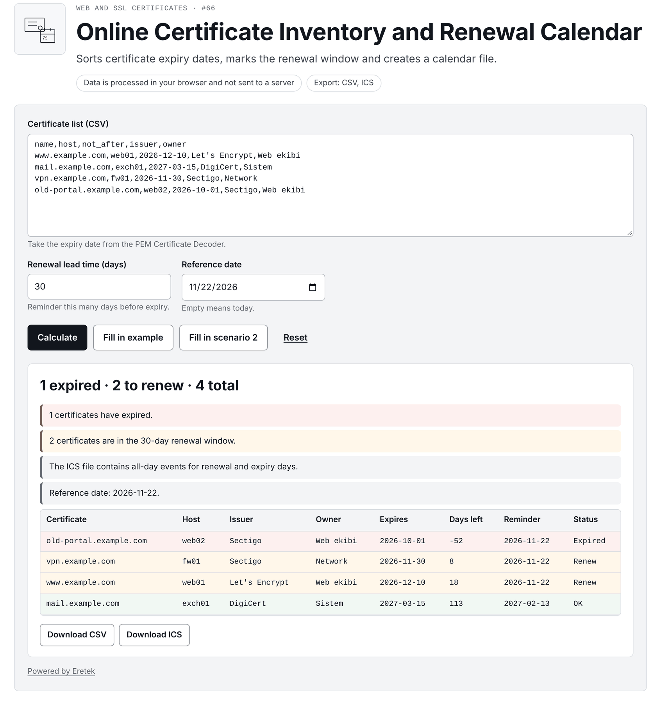

# Certificate Inventory and Renewal Calendar

Find expired and expiring certificates from a CSV list and create an ICS file with renewal reminders and expiry dates for your calendar.

## Try it live

- [Türkçe](https://web.eretek.com/araclar/sertifika-yenileme-takvimi)
- [English](https://web.eretek.com/en/tools/certificate-renewal-calendar)
- [Deutsch](https://web.eretek.com/de/werkzeuge/zertifikat-erneuerungskalender)



## What it does

Sorts certificate expiry dates, marks the renewal window and creates a calendar file.

An expired certificate stops a website, VPN, email or RADIUS authentication instantly. When certificates are spread across providers and teams, reminder emails get missed. The tool turns one list into a status table and an ICS file for Outlook or Google Calendar.

## Where it helps

Import the ICS into the team calendar and update the list with every new certificate. For auto-renewed (ACME) certificates, verify that renewal actually works.

## How to use it

1. CSV header: `name, not_after` required; `host, issuer, owner` optional. Date `YYYY-MM-DD` or `DD.MM.YYYY`.
2. Enter how many days before expiry renewal should start and optionally a reference date (empty = today).
3. Press Run; download the table as CSV and reminders as ICS.

### Fields

| Field | Description |
|---|---|
| Certificate list (CSV) | Take the expiry date from the PEM Certificate Decoder. |
| Renewal lead time (days) | Reminder this many days before expiry. |
| Reference date | Empty means today. |

## Example input

Press **Fill in example** in the tool to load this input.

| Input | Value |
|---|---|
| Renewal lead time (days) | `30` |
| Reference date | `2026-11-22` |

**Certificate list (CSV)**

```text
name,host,not_after,issuer,owner
www.example.com,web01,2026-12-10,Let's Encrypt,Web ekibi
mail.example.com,exch01,2027-03-15,DigiCert,Sistem
vpn.example.com,fw01,2026-11-30,Sectigo,Network
old-portal.example.com,web02,2026-10-01,Sectigo,Web ekibi
```

**Expected result:** As of 22 November 2026 old-portal expired 52 days ago; vpn (8 days) and www (18 days) are in the 30-day renewal window; mail in 113 days.

## Method and assumptions

Days left = expiry − reference date (UTC days). Status: < 0 expired, ≤ lead time due, otherwise fine. ICS: RFC 5545 all-day events with stable UIDs so re-imports do not duplicate.

## Limits and common mistakes

- Certificates are not read remotely; accuracy depends on the input. Time zone differences are ignored in day counts.

## Run it locally

The tool is plain HTML, CSS and JavaScript with no build step and no dependencies.

```bash
git clone https://github.com/eretek/certificate-renewal-calendar.git
cd certificate-renewal-calendar
node scripts/serve.js        # or: python3 -m http.server 8080
```

Open <http://127.0.0.1:8080/>. Add `?lang=tr` or `?lang=de` for Turkish or German; without it the page follows the browser language and falls back to English. You can also open `index.html` directly from disk.

Run the tests (Node.js 18 or later):

```bash
node test/run.js    # or: npm test
```

The tests run the tool's own fixtures and the worked examples in all three languages without a browser.

## How it works

All processing happens in your browser. The tool makes no network requests, uses no cookies or browser storage, and does not upload files you select.

No server-side component is needed. The version on the Eretek website renders the same page through a private WordPress plugin; that plugin only produces the page markup and is not part of this repository.

| Path | Purpose |
|---|---|
| `index.html` | Page shell |
| `src/app.js` | Builds the page in Turkish, English or German from `src/data.js` |
| `src/data.js` | Field definitions, examples and all texts in three languages |
| `src/core.js` | Shared runtime: validation, number formats, result rendering, CSV/ICS export |
| `src/tool.js` | The calculation or analysis for this tool |
| `docs/screenshot.png` | Screenshot used in this README |
| `src/tools.css`, `src/page.css` | Styles |
| `test/run.js`, `test/cases.json` | Headless tests |

## License and attribution

This tool is released under the [Eretek Website Attribution License](LICENSE). You may use, modify and redistribute it, including commercially. If you make it available on a website or web application, show a visible, clickable credit linking to https://eretek.com/ on every page where the tool is available, for example:

```html
<a href="https://eretek.com/">Powered by Eretek</a>
```

You may add `rel="nofollow"` to the link. Keep the copyright notice and license text in copies and redistributions.
